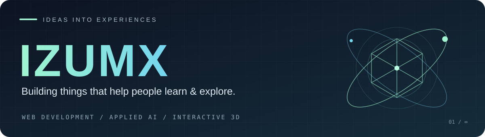

  

  <a href="#selected-projects">Selected projects</a> &nbsp; / &nbsp;
  <a href="#toolbox">Toolbox</a> &nbsp; / &nbsp;
  <a href="https://github.com/Izumx?tab=repositories">All repositories ↗</a>

 

### Hey, I'm Eskendir — Izumx.

I build web apps, interactive 3D experiences and tools with AI. Based in Kazakhstan, I enjoy turning complex ideas into interfaces people can explore, understand and use.

**My projects connect education, technology and everyday problems.**

 

## Selected projects

<table>
<tr>
<td width="50%" valign="top">

### 01 &nbsp; OylaTap
**Learn through short videos.**

An educational video platform with creator tools, quizzes and classroom features in Russian and Kazakh.

React · TypeScript · Express · PostgreSQL

  
<a href="https://github.com/Izumx/OylaTap"><b>Explore OylaTap ↗</b></a>

</td>
<td width="50%" valign="top">

### 02 &nbsp; EduLab 3D
**Make science tangible.**

Interactive 3D school laboratories with hand tracking, from building molecules to exploring the Solar System.

React · Three.js · React Three Fiber · MediaPipe

  
<a href="https://github.com/Izumx/EDULAB-3D"><b>Explore EduLab ↗</b></a>

</td>
</tr>
<tr>
<td width="50%" valign="top">

### 03 &nbsp; ЖерКөз / ZerKoz
**Connect maps and communities.**

Land monitoring dashboard and citizen Telegram bot, with a shared workflow for reports and inspections.

Maps · Telegram · Satellite data · RU / KK

  
<a href="https://github.com/Izumx/ZerKoz"><b>Explore ZerKoz ↗</b></a>

</td>
<td width="50%" valign="top">

### 04 &nbsp; TazaTender
**Turn data into explainable signals.**

A public procurement risk analysis project that combines machine learning, relationship graphs and text analysis.

Python · FastAPI · React · CatBoost · SHAP

  
<a href="https://github.com/Izumx/TazaTender"><b>Explore TazaTender ↗</b></a>

</td>
</tr>
<tr>
<td width="50%" valign="top">

### 05 &nbsp; IELTS NewsSync
**Read the news. Build your English.**

A bilingual IELTS reader with vocabulary highlights, an AI tutor, quizzes and spaced repetition flashcards.

Next.js · TypeScript · Tailwind CSS · Supabase

  
<a href="https://github.com/Izumx/AI_NEWSSYNC"><b>Explore NewsSync ↗</b></a>

</td>
<td width="50%" valign="top">

### 06 &nbsp; OrbitClean
**Explore the space around us.**

A browser 3D project about orbital debris, combining satellite data with educational gameplay. In development.

React · Three.js · TypeScript · satellite.js

  
<a href="https://github.com/Izumx/Orbit-Cleaner-Game"><b>Explore OrbitClean ↗</b></a>

</td>
</tr>
</table>

 

## Toolbox

**Interfaces** &nbsp; `TypeScript` `JavaScript` `React` `Next.js` `Tailwind CSS`

**APIs & data** &nbsp; `Python` `FastAPI` `Express` `PostgreSQL`

**Interactive & intelligent** &nbsp; `Three.js` `React Three Fiber` `MediaPipe` `AI integrations`

 

---

  Curious about a project? Open its repository and take a look around. 
  <a href="https://github.com/Izumx?tab=repositories"><b>See what I'm building ↗</b></a>

